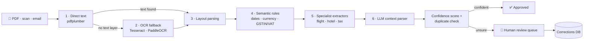
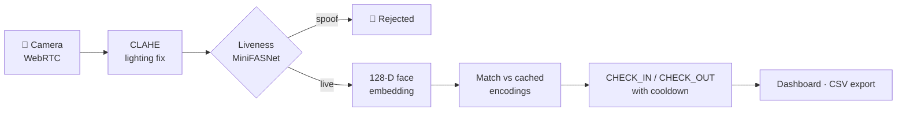

<p align="center">
  
</p>

<p align="center">
  <a href="https://linkedin.com/in/radhesh-dahagam"></a>
  <a href="mailto:dahagamradhesh9@gmail.com"></a>
  
</p>

> **A README, written as a model card.**
> I document models by saying what they're for, how they were trained, how they perform, and where they fail. Seemed only fair to do the same for myself.

---

## 🪪 Model card: `radhesh`

```yaml
model:          radhesh
version:        2026
task:           ship ML systems that survive real users
architecture:   full-stack (ML + FastAPI + Next.js)
base:           B.Tech CSE, VIT Amaravathi (2021–2025)
fine_tuned_on:
  - Microsoft Azure AI Fundamentals (AI-900)
  - Google Cybersecurity Professional Certificate
languages:      [Python, TypeScript, JavaScript, Java, SQL]
status:         deployed, working as an AI/ML Engineer
```

### What I'm for

- Turning **messy real-world input** (skewed scans, badly lit webcam frames, noisy records) into output a business can trust.
- Wrapping models in the unglamorous parts that make them usable: async queues, confidence scores, review UIs, RBAC, audit logs.
- Building it **end to end**: model → API → interface.

**Out of scope:** notebook-only demos with no path to deployment.

---

## 📊 Evaluation

| System | Task | Result | Data |
| :-- | :-- | :-- | :-- |
| [**AutoExtract**](https://github.com/RadheshD/AutoExtract) | Document field extraction | **82%** extraction accuracy · 100% pass on the E2E suite | 25 complex invoice/document variants |
| [**Bone Fracture Detection**](https://github.com/RadheshD/Bone-Fracture-Detection) | X-ray classification | **91%** accuracy (MobileNet + Random Forest hybrid) | 3,000+ labeled X-rays |
| **Crime Pattern Prediction** | Hotspot forecasting | **87%** accuracy (tuned ensembles) | 10,000+ historical records |
| [**FaceAttend AI**](https://github.com/RadheshD/Face-Recognition-System) | Attendance via face recognition | Fully on-prem, with a liveness check against photo/video replay | n/a |

<sub>All numbers are self-reported on my own test sets.</sub>

---

## 🔬 Systems under the hood

### AutoExtract: a 6-layer pipeline that escalates only when it has to

Deterministic layers first, OCR as a fallback, LLM last. Anything the system isn't sure about goes to a human.



### FaceAttend AI: on-prem, zero cloud dependency

<sub>Simplified view.</sub>



---

## 🧰 Tools, with receipts

Not a badge wall. Here's where each tool actually earned its place.

| Tool | Where it earned its keep |
| :-- | :-- |
| **Python** | Everything below |
| **FastAPI** | AutoExtract API · FaceAttend AI backend |
| **Redis · Celery** | AutoExtract's async processing pipeline |
| **Next.js · TypeScript** | AutoExtract web UI · APERTURE |
| **Tesseract · PaddleOCR · LLMs** | AutoExtract's OCR and context-parsing layers |
| **OpenCV · dlib · PyTorch** | FaceAttend: face embeddings and MiniFASNet liveness |
| **TensorFlow · MobileNet · scikit-learn** | Bone fracture detection |
| **Pandas · NumPy · Seaborn** | Crime pattern prediction |
| **Matplotlib · ReportLab** | Crime dashboards · cric-stats-hub reports |
| **SQLite · MySQL** | AutoExtract, FaceAttend · Bone Fracture, cric-stats-hub |

---

## 🧪 Side quests

- 🎛️ **[APERTURE](https://github.com/RadheshD/APERTURE)**: an interactive design lab that teaches complete beginners to see, think and build like designers, by training perception before vocabulary.
- 🏏 **[cric-stats-hub](https://github.com/RadheshD/cric-stats-hub)**: cricket match data in, visual PDF reports and a MySQL export out.

---

## ⚠️ Limitations & next training run

- **Still levelling up:** deeper ML systems design, MLOps, and scalable backend architecture. That's the current focus.
- **Known quirk:** gets unreasonably invested in loading states and microcopy.

---

## 📡 Inference endpoint

```python
radhesh.reach_out(via=["linkedin", "email"])
```

[LinkedIn](https://linkedin.com/in/radhesh-dahagam) · [Email](mailto:dahagamradhesh9@gmail.com) · [GitHub](https://github.com/RadheshD)

---

```text
$ python train.py --objective curiosity
epoch 42/∞ · curiosity_loss: ↓ decreasing
```
