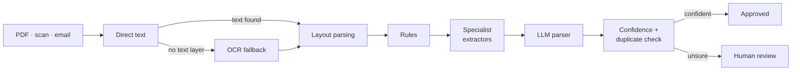
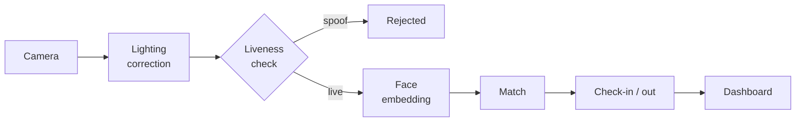

<h1 align="center">Radhesh Dahagam</h1>

  <b>AI/ML Engineer</b> 
  I build production ML systems, not just notebooks.

  <a href="#selected-work">Work</a> &nbsp;·&nbsp;
  <a href="#stack">Stack</a> &nbsp;·&nbsp;
  <a href="#background">Background</a> &nbsp;·&nbsp;
  <a href="#contact">Contact</a>

  
  

---

## About

I take models all the way to something people actually use: the API, the review queue, the audit log. Two systems I built end to end are in production, a document-intelligence platform and an on-prem face-recognition attendance kiosk. Right now I'm going deeper on ML systems design, MLOps and scalable backends.

---

## Selected work

### [AutoExtract](https://github.com/RadheshD/AutoExtract): document intelligence platform

Turns invoices, receipts, tickets and scanned PDFs into structured, validated data.

- Hybrid **6-layer extraction pipeline**: direct text → OCR (Tesseract, PaddleOCR) → layout parsing → rules → specialist extractors → LLM
- Confidence scoring, duplicate detection and a **human-in-the-loop review queue**, with RBAC and audit logging
- **82%** extraction accuracy across 25 complex document variants

`Python` `FastAPI` `Redis` `Celery` `Next.js` `SQLite`

View pipeline

### [FaceAttend AI](https://github.com/RadheshD/Face-Recognition-System): on-prem attendance kiosk

Real-time face recognition with no cloud dependency.

- 128-D face embeddings matched against an in-memory cache for fast identification
- **Liveness detection** (MiniFASNet) to block photo and video spoofing
- CLAHE preprocessing for glare, low light and shadows; automatic check-in/out with an analytics dashboard

`Python` `FastAPI` `OpenCV` `PyTorch` `SQLite`

View pipeline

---

## More projects

| Project | What it does | Result |
| :-- | :-- | :-- |
| [**Bone Fracture Detection**](https://github.com/RadheshD/Bone-Fracture-Detection) | Classifies fractures from X-rays (MobileNet + Random Forest) with a REST-backed web app | 91% accuracy on 3,000+ images |
| **Crime Pattern Prediction** | Forecasts crime hotspots with tuned ensemble models and visual dashboards | 87% accuracy on 10,000+ records |
| [**APERTURE**](https://github.com/RadheshD/APERTURE) | Interactive design lab that teaches beginners to see, think and build like designers | TypeScript |
| [**cric-stats-hub**](https://github.com/RadheshD/cric-stats-hub) | Turns cricket match data into visual PDF reports and a MySQL export | Python |

---

## Stack

| Area | Tools |
| :-- | :-- |
| Languages | Python · TypeScript · JavaScript · Java · SQL · HTML/CSS |
| ML & vision | TensorFlow · PyTorch · scikit-learn · OpenCV · Pandas · NumPy |
| Backend | FastAPI · Next.js · Redis · Celery |
| Data | SQLite · MySQL |
| Cloud & tools | Microsoft Azure · Git |

---

## Background

- **B.Tech, Computer Science and Engineering**, VIT Amaravathi (2021–2025)
- Microsoft Azure AI Fundamentals (AI-900)
- Google Cybersecurity Professional Certificate

---

## Contact

Happy to talk about ML systems, document AI and computer vision.

[LinkedIn](https://linkedin.com/in/radhesh-dahagam) · [Email](mailto:dahagamradhesh9@gmail.com)
